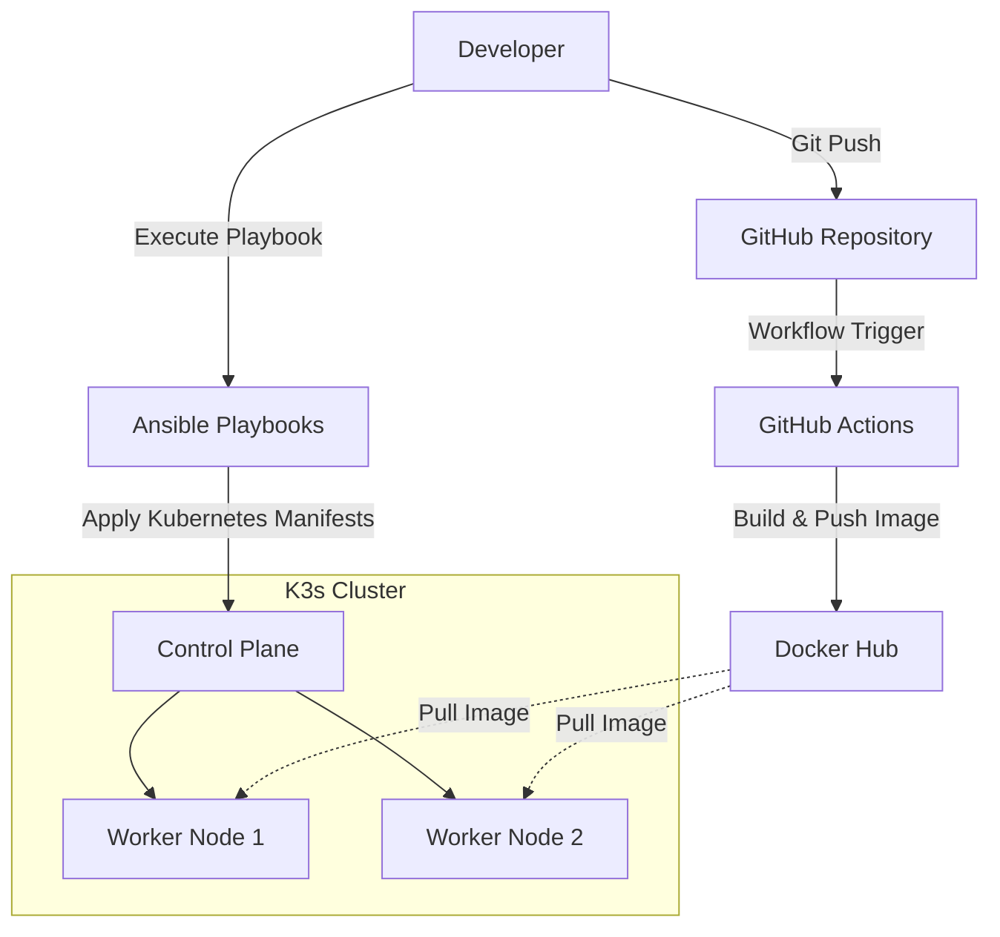

# Automated Kubernetes Deployment

<div align="center">

**Automating the deployment of a containerized Flask application to a multi-node Kubernetes cluster.**

Built with Docker, K3s, Ansible and GitHub Actions.

<br/>


</div>

---

## Overview

This project explores the automation of an application deployment workflow, from Docker image creation to deployment on a Kubernetes cluster.

The infrastructure consists of three Ubuntu virtual machines running K3s, with one control-plane node and two worker nodes.

GitHub Actions handles image building and publishing, while Ansible automates Kubernetes deployment operations.

## Architecture



## Technology Stack

| Technology | Purpose |
|---|---|
|  Python / Flask | REST API |
|  Docker | Application containerization |
|  K3s | Kubernetes orchestration |
|  Ansible | Infrastructure and deployment automation |
|  GitHub Actions | CI pipeline |
|  Docker Hub | Container image registry |
| Ubuntu | Virtual machine operating system |

## Implementation

### 01. Application Development

Developed a lightweight Python API using Flask.

- Returns JSON responses containing the application version.
- Supports version changes to test application updates.
- Uses a simple structure with static assets and templates.

### 02. Containerization

Packaged the Flask application into a Docker image.

- Uses `python:3.9-slim` as the base image.
- Builds the `fwassim/marineford-api` image.
- Publishes the image to Docker Hub.

### 03. Continuous Integration

Implemented a GitHub Actions workflow in `.github/workflows/ci.yml`.

- Triggered by pushes to the `main` branch.
- Authenticates with Docker Hub using GitHub Secrets.
- Builds the application image.
- Publishes the image to the registry.

### 04. Kubernetes Infrastructure

Set up a multi-node K3s cluster across three Ubuntu virtual machines.

- One control-plane node.
- Two worker nodes.
- Kubernetes Deployment and Service manifests.
- Application deployment across the worker nodes.

### 05. Deployment Automation

Created Ansible playbooks to automate cluster configuration and application deployment.

- Configures worker nodes.
- Installs and joins K3s workers to the cluster.
- Synchronizes Kubernetes manifests.
- Applies deployment and service configurations.
- Triggers application rollout restarts.

## Challenges & Solutions

### Dynamic IP Addressing

**Problem**

Virtual machines initially relied on DHCP. IP addresses changed after reboots, disrupting communication between cluster nodes and Ansible.

**Solution**

Configured static IP addresses on Ubuntu virtual machines using Netplan to maintain stable network connectivity.

### Docker Image Caching

**Problem**

Kubernetes continued using a previously cached image when application updates were published under the same image tag.

**Solution**

Configured `imagePullPolicy: Always` in the Kubernetes Deployment manifest to make Kubernetes check the registry for the image when starting containers.

## Repository Structure

```text
.
├── .github/
│   └── workflows/
│       └── ci.yml
├── Ansible/
│   ├── hosts.ini
│   ├── deploy_image.yml
│   ├── join_k3s.yml
│   ├── install_docker.yml
│   ├── nginx.yml
│   └── deploy_app.yml
├── app/
│   ├── app.py
│   ├── static/
│   └── templates/
├── Dockerfile
├── requirements.txt
├── service.yml
└── marineford.yml
```

## Roadmap

- [ ] GitOps deployment with ArgoCD.
- [ ] Monitoring and visualization with Prometheus and Grafana.
- [ ] Ingress configuration for external application access.

---

<div align="center">

**Developed by [FWassim](https://github.com/FWassim)**

<sub>Learning by building, automating and improving.</sub>

</div>
