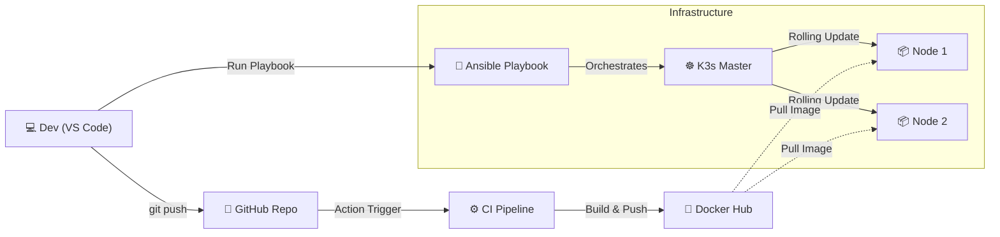

# ⚓ Project Marineford: End-to-End DevOps CI/CD Pipeline

<div align="center">
  
</div>

---

## 🏴‍☠️ Context and Disclaimer
The name **"Marineford"** is a reference to the iconic arc from the *One Piece* anime. I enjoy adding a narrative layer to my engineering projects to make them more engaging.

While the theme is fictional, the infrastructure, automation, and technologies used here are **100% real and strictly professional.** 

---

## 📋 Project Overview

This project demonstrates a complete **DevOps Lifecycle** implementation. It starts with a Python Flask application and ends with an automated deployment on a Kubernetes cluster, orchestrated by Ansible and GitHub Actions.

**The Goal:** Build a resilient, self-healing architecture with **Zero Downtime** deployment capabilities.

### 🛠 Technology Stack


---

## 🏗 Architecture & Pipeline

The workflow follows a strict **DevOps** pipeline:

1.  **Development:** Code written in Python (Flask) on VS Code (Remote SSH).
2.  **Containerization:** Application packaged into a lightweight Docker container.
3.  **Continuous Integration (CI):** GitHub Actions automatically builds and pushes the image to Docker Hub upon every commit to `main`.
4.  **Infrastructure:** A multi-node **Kubernetes (K3s)** cluster (1 Master, 2 Workers).
5.  **Continuous Deployment (CD):** Ansible automates the orchestration, instructing Kubernetes to perform Rolling Updates without service interruption.

### 📐 Architecture Diagram


---

## The Workflow:

### 1. The Application Layer (`app.py`)
A Python API serving as the core microservice.
* **Logic:** Returns JSON responses indicating the current version.
* **Evolution:** Capable of seamless version upgrades (V1 -> V2 -> V3).

### 2. Containerization (Docker)
I used a multi-stage `Dockerfile` strategy.
* **Base Image:** `python:3.9-slim` for minimized footprint.
* **Registry:** Images are pushed to Docker Hub (`fwassim/marineford-api`).
* **Tagging Strategy:** Uses `imagePullPolicy: Always` to ensure the latest artifact is deployed.

### 3. CI Pipeline (GitHub Actions)
Located in `.github/workflows/ci.yml`.
* **Trigger:** Push to `main`.
* **Action:** Authenticates with Docker Hub secrets, builds the image, and pushes it to the registry.

### 4. CD Pipeline (Ansible)
Located in `Ansible/deploy_app.yml`.
Instead of manual operations, Ansible acts as the **Admiral** of the fleet:
1.  **Git Pull:** Synchronizes infrastructure manifests.
2.  **Kubectl Apply:** Updates the cluster state.
3.  **Rollout Restart:** Triggers a zero-downtime update.

---

## ⚡ Challenges and Solutions
### 🛑 The "Floating IP" Issue
**Problem:** Initially, the Virtual Machines were using DHCP (dynamic IPs). Every time the VMs rebooted, the IP addresses changed, breaking the communication between the Kubernetes Master and Workers, and causing the Ansible inventory to fail.

**Solution:**
* I manually reconfigured the network layer of the Ubuntu VMs.
* I modified the **Netplan configuration** (`/etc/netplan/`) to enforce **Static IP addresses** for all nodes.
* This ensured permanent connectivity and stability for the Cluster and Ansible automation.

### 🛑 The "Image Cache" Trap
**Problem:** Kubernetes wasn't pulling the new code updates because it cached the `v1` image locally.
**Solution:** I implemented `imagePullPolicy: Always` in the deployment manifest to force K3s to check the registry for updates, even if the tag remains the same.

---
## 📂 Project Structure

```text
marineford/
├── .github/
│   └── workflows/
│       └── ci.yml          # GitHub Actions Pipeline definition
├── Ansible/
│   ├── hosts.ini           # Inventory (Master and Workers)
│   ├── deploy_image.yml
│   ├── join_k3s.yml        # Install k3s on the Workers and connecting them with the Master
│   ├── install_docker.yml  # Installing Docker on the Workers
│   ├── nginx.yml           # To test the cluster
│   └── deploy_app.yml      # The CD Playbook
├── app/
│   ├── app.py              # Python Application
│   ├── static  
│   └── templates      
├── Dockerfile              # Docker instructions
├── requirements.txt        # Python dependencies
├── service.yml        
└── marineford.yml          # Kubernetes Deployment and Service manifests
```
---
## 🔮 Future Work

The next immediate steps for this project are:

- [ ] **GitOps Implementation:** Replacing the push-based model (Ansible) with a pull-based model using **ArgoCD**.
- [ ] **Observability:** Deploying a full monitoring stack with **Prometheus & Grafana** via Helm Charts to visualize CPU/RAM metrics.
- [ ] **Ingress Controller:** Setting up Traefik or Nginx for proper domain routing and HTTPS.
---
*Project created by **FWassim** - 2026*
